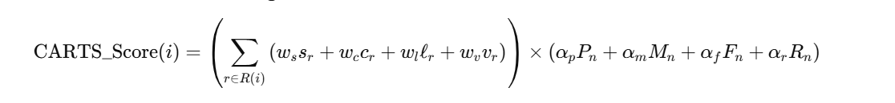

# CARTS: Context-Aware Recommendation and Transaction System

CARTS recommends products for a shopping cart using **association rules (Apriori)** re-ranked by
**business value**. A suggestion ranks high when customers really buy the items together *and*
it makes money for the store.

It comes with a **web shop** that recommends as you fill the cart, an **analytics dashboard** to
inspect and tune the model, a **CLI**, and tests. It runs on **real retail data**: the UCI / Kaggle
*Online Retail* dataset (18,559 invoices, 500 products, real prices).

📄 **Paper / full write-up:** [docs/CARTS_paper.md](docs/CARTS_paper.md)

## The CARTS score



For each candidate item *i*, CARTS sums the strength of every rule that fires for the cart (support,
confidence, lift, conviction). It then multiplies that sum by the item's business factor (profit per
unit, margin %, purchase frequency, revenue). Each metric is Z-score normalised and squashed to (0, 1),
and all eight weights can be adjusted on the dashboard. Details and rationale are in the paper, §3.

**Result on real data (hold-out test, top-5):** with default weights, CARTS recommends items worth
**19% more profit each** than plain Apriori, at a hit rate of 21.1% vs 23.2%. With profit-focused
weights, suggestions are worth **65% more**, and realised profit is slightly above Apriori's. See paper §6.

## Quick start

```bash
pip install -r requirements.txt
```

```bash
python app.py
```

Open http://127.0.0.1:5000 for the shop and http://127.0.0.1:5000/dashboard for the dashboard.

Command line:

```bash
python carts_apriori.py recommend "Jumbo Bag Red Retrospot" "Lunch Bag Red Retrospot"
```

```bash
python carts_apriori.py evaluate
```

```bash
python -m pytest -q
```

## What's in the app

| Page | What you can do |
|---|---|
| **Shop** `/` | Search and filter products, build a cart, see live recommendations with an explanation each ("Bought with X · confidence 29% · lift 4.6"), switch between CARTS and Apriori, check out. Orders are stored with the recommendations shown and accepted. |
| **Dashboard** `/dashboard` | KPIs; CARTS vs Apriori hold-out evaluation; most frequent products; revenue and profit by category; a rule explorer comparing CARTS and Apriori ranks; sliders for mining thresholds and all weights (retrains in about 2 s); an editable item master (rescores immediately); dataset upload; order log with recommendation acceptance rate. |

## Data

`data/transactions.csv` and `data/item_master.csv` are built from the raw UCI file by a reproducible script:

```bash
curl -L -o online_retail.zip https://archive.ics.uci.edu/static/public/352/online+retail.zip
```

```bash
python scripts/prepare_online_retail.py "Online Retail.xlsx"
```

- **Source:** D. Chen, *Online Retail*, UCI Machine Learning Repository (2015), https://doi.org/10.24432/C5BW33, CC BY 4.0.
  Kaggle mirror: [E-Commerce Data](https://www.kaggle.com/datasets/carrie1/ecommerce-data).
- **Real:** baskets, selling prices, quantities, revenue.
- **Derived:** categories (keyword rules on product descriptions).
- **Estimated:** cost prices. The dataset has none, so they are set from assumed category margins of
  40–60%. Replace them with real costs on the dashboard or by uploading an item master.

### Using your own data

Upload on the dashboard, or pass `--transactions` and `--item-master` to the CLI. Supported transaction formats:

- one basket per row, no header: `milk,bread,eggs`
- a wide table: `Transaction_ID, Item_1, Item_2, …` or `Item(s), Item 1, …`
- a long table, one row per item, grouped by id and date, e.g. Kaggle's
  [Groceries dataset](https://www.kaggle.com/datasets/heeraldedhia/groceries-dataset) (`Member_number, Date, itemDescription`)

The item master (CSV or XLSX) needs item name, cost price and selling price. Category, units sold and
revenue are optional. Products without a price get the catalogue median and are flagged.

## Project layout

```
app.py                         Flask web app + JSON API
carts_apriori.py               CLI
carts_engine/
  data.py                      dataset loading, format detection, item master
  engine.py                    Apriori + CARTS scoring, recommendations, evaluation
  store.py                     SQLite order log
templates/, static/            shop and dashboard UI
scripts/prepare_online_retail.py   raw UCI file -> data/
data/                          prepared dataset + dataset.json (source, licence, defaults)
docs/CARTS_paper.md            paper
tests/test_carts.py            unit + API tests
```

Runtime state (orders, uploaded datasets, saved settings) lives in `instance/`, which is git-ignored.
Set `CARTS_INSTANCE` to use a different folder.

## API

| Method & path | Body / params | Returns |
|---|---|---|
| `GET /api/products` | `q`, `category`, `sort` | catalogue |
| `POST /api/recommend` | `{cart: [...], strategy: "carts"\|"apriori", top_n}` | recommendations with reasons |
| `POST /api/checkout` | `{lines: [{item, qty}], strategy, recommended: [...]}` | order |
| `GET /api/stats` | | dataset KPIs, config, order summary |
| `GET /api/rules` | `strategy`, `q`, `limit` | ranked rules |
| `GET /api/evaluate` | `refresh` | hold-out evaluation |
| `POST /api/config` | thresholds, `rule_weights`, `item_weights`, `include_orders` | retrains |
| `PUT /api/items/<name>` | `{cost_price, selling_price}` | rescored item |
| `POST /api/dataset` | multipart `transactions`, `item_master`, `currency` | retrains on uploaded data |

## Tech stack

Python · pandas · NumPy · mlxtend (Apriori) · Flask · SQLite · Chart.js

## License

MIT, see [LICENSE](LICENSE). The Online Retail dataset is CC BY 4.0 (Chen, 2015).
