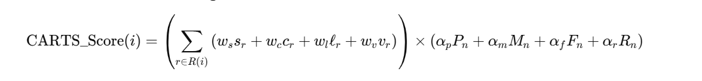
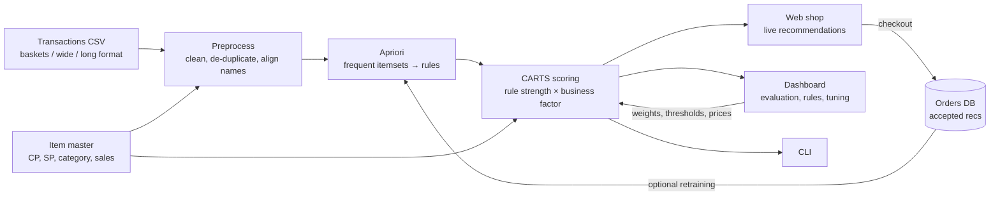

# CARTS: Context-Aware Recommendation and Transaction System

*Profit-aware association-rule recommendations for retail baskets*

**Akshat Shah**

---

## Abstract

Frequent-pattern recommenders such as Apriori rank "customers who bought A also bought B" rules by
how often they occur. That ignores what a retailer cares about: the money each suggestion makes.
CARTS keeps Apriori's rule mining and re-ranks its output with a two-part score. The first part
measures rule strength (support, confidence, lift, conviction). The second measures the business
value of the recommended item (profit per unit, margin, purchase frequency, revenue). Every metric
is Z-score normalised and mapped to (0, 1), and the two parts are multiplied. We evaluate CARTS on
the public **UCI Online Retail** dataset (18,559 real invoices, 500 products, real selling prices).
In a hold-out test the default weights raise the average profit of recommended items by **19%**
over plain Apriori, and the hit rate drops from 23.2% to 21.1%. With weights focused on profit,
profit per suggestion rises by **65%**, and the profit actually realised from correctly predicted
purchases is slightly higher than Apriori's. CARTS ships as a Python package with a web shop that
recommends live as the cart fills, a dashboard to tune and inspect the model, and a CLI.

---

## 1. Introduction

Market basket analysis finds products that are bought together, for example "customers who buy
tea often buy biscuits as well". Retailers use it to cross-sell, plan store layouts and design
bundles. The standard tool, Apriori [1, 2], ranks rules by support and confidence, so every
product counts the same. A rule that sells a low-margin staple outranks one that sells a
high-margin accessory, provided the first occurs more often.

CARTS (Context-Aware Recommendation and Transaction System) adds the missing business context. It:

1. mines association rules with Apriori, unchanged;
2. scores each rule by its statistical strength *and* the business value of the item it recommends;
3. for a live cart, sums the evidence from every rule that fires for each candidate item;
4. records the resulting transactions, including which recommendations were accepted, so they can be
   measured and fed back into training.

**Contributions.** (i) A multiplicative scoring function that combines four rule metrics with four
item-level business metrics, with explicit normalisation. (ii) An open-source implementation with
a web shop, an analytics dashboard and a CLI. (iii) An honest hold-out evaluation on real retail
data that measures the trade-off between predictive accuracy and profit.

## 2. Background

**Association rules.** For itemsets *A* and *B* over *N* transactions [1]:

| Metric | Definition | Meaning |
|---|---|---|
| Support | s(A→B) = \|A ∪ B\| / N | how common the pattern is |
| Confidence | c(A→B) = s(A ∪ B) / s(A) | P(B \| A) |
| Lift | ℓ(A→B) = c(A→B) / s(B) | how much more likely B is given A than overall |
| Conviction | v(A→B) = (1 − s(B)) / (1 − c(A→B)) | how often the rule would be wrong if A and B were independent [3] |

Apriori [2] finds all itemsets with support ≥ *min_support* by growing candidates level by level.
Rules with confidence ≥ *min_confidence* are then generated from those itemsets.

**Limitation.** Apriori's ranking only reflects frequency. Profit-aware mining has been studied
before, for example product selection that accounts for cross-selling profit (PROFSET [4]) and
profit mining [5]. CARTS takes a lightweight post-processing approach: the mining step is untouched,
so the method works with any Apriori or FP-Growth implementation.

## 3. The CARTS score

For a cart *C* and a candidate item *i* ∉ *C*, let *R(i)* be the set of mined rules *A → i* whose
antecedent is fully contained in the cart (*A* ⊆ *C*). Then

$$
\text{Score}(i) = \Bigg(\sum_{r \in R(i)} w_s\,s_r + w_c\,c_r + w_l\,\ell_r + w_v\,v_r\Bigg) \times
\big(\alpha_p P_n + \alpha_m M_n + \alpha_f F_n + \alpha_r R_n\big)
$$

| Symbol | Meaning | Default weight |
|---|---|---|
| sr, cr, ℓr, vr | support, confidence, lift, conviction of rule *r* | ws 0.25, wc 0.35, wl 0.25, wv 0.15 |
| Pn | profit per unit of *i*: SP − CP | αp 0.35 |
| Mn | margin % of *i*: (SP − CP) / SP | αm 0.25 |
| Fn | frequency of *i*: share of baskets containing *i* | αf 0.20 |
| Rn | revenue of *i* over the data period | αr 0.20 |

**Normalisation.** The metrics live on very different scales: support is around 0.01, lift can be
30, profit is in currency units. Each metric *x* is therefore standardised, then passed through the
logistic function:

$$ x_n = \sigma\big(Z(x)\big) = \frac{1}{1 + e^{-(x-\mu)/\sigma_x}} $$

Rule metrics are normalised over all mined rules and item metrics over all products. A Z-score
alone could be negative, and a negative business factor multiplied by a strong rule would flip the
ranking. The logistic step keeps both brackets in (0, 1), where 0.5 means average. It also damps
the heavy right tails of lift and conviction. Each weight group is rescaled to sum to 1. Infinite
conviction (confidence = 1) is capped at the largest finite value.

**Design notes.**

- *Why multiply?* The business factor scales the evidence. An item that no rule supports scores
  zero no matter how profitable it is, so CARTS cannot push unrelated high-margin products.
  Among items the cart does support, the more valuable ones move up.
- *Why sum over rules?* If several rules recommend the same item (for example {tea} → biscuits and
  {bread} → biscuits), the evidence adds up.
- *Profit vs margin.* Profit % on cost and margin % on price are monotone transforms of each other
  (m = p / (1 + p)), so using both would count one signal twice. CARTS uses **absolute profit per
  unit** for P and margin % for M. Section 6 shows why this matters.
- *Fallbacks.* If fewer than *N* items have a fully firing rule, partly matching rules fill the list,
  weighted by 0.5 × the fraction of the antecedent present in the cart. After that, items with the
  highest business factor fill it (cold start).

**Baseline.** "Apriori" in this document ranks each candidate by its best firing rule's
support × confidence. This is the frequency-only ranking of the original CARTS prototype.

**Toy example** (Tables I and II of the original draft: 7 products, 10 baskets, min support 0.2,
min confidence 0.5). Tea has the highest profit per unit (Rs 30) and is frequent, so its business
factor is the highest (0.73). The rule {Biscuits} → Tea moves from Apriori rank 2 to CARTS rank 1,
while {Bread} → Biscuits drops from rank 3 to rank 6:

| Rule | Support | Confidence | Lift | Rule strength | Business factor | CARTS rank | Apriori rank |
|---|---|---|---|---|---|---|---|
| Biscuits → Tea | 0.4 | 0.67 | 1.33 | 0.527 | 0.732 | **1** | 2 |
| Tea → Biscuits | 0.4 | 0.80 | 1.33 | 0.626 | 0.613 | 2 | **1** |
| Juice → Biscuits | 0.2 | 1.00 | 1.67 | 0.618 | 0.613 | 3 | 4 |
| {Bread, Tea} → Biscuits | 0.2 | 1.00 | 1.67 | 0.618 | 0.613 | 3 | 4 |
| Oil → Rice | 0.2 | 1.00 | 3.33 | 0.722 | 0.482 | 5 | 4 |
| Bread → Biscuits | 0.3 | 0.75 | 1.25 | 0.514 | 0.613 | 6 | 3 |

(Reproduce with `pytest tests/test_carts.py`; the fixture uses exactly this data.)

## 4. System architecture

| Component | File | Role |
|---|---|---|
| Data loading | `carts_engine/data.py` | Auto-detects the transaction format (one basket per row; wide `Item 1..n` table; long `id, date, item` table such as Kaggle's Groceries). Normalises item-master column names and computes profit and margin. |
| Engine | `carts_engine/engine.py` | Apriori via `mlxtend`, the CARTS score, recommendations, hold-out evaluation. |
| Orders | `carts_engine/store.py` | SQLite log of checkouts with the recommendations shown and accepted. |
| Web app | `app.py`, `templates/`, `static/` | Shop page, dashboard, JSON API. |
| CLI | `carts_apriori.py` | `recommend`, `rules`, `products`, `evaluate`. |
| Data prep | `scripts/prepare_online_retail.py` | Reproducible cleaning of the raw UCI file. |

**Cost.** CARTS adds only post-processing to Apriori. Mining is unchanged, and scoring is
O(|rules| + |items|). Answering a cart query is a matrix-vector product over the rule × item
antecedent matrix. Measured on the dataset below (one laptop core): mining 1.9 s for 2,584 rules,
full rescoring after a price or weight change 42 ms, one recommendation 0.5 ms. Earlier drafts
claimed CARTS reduces Apriori's asymptotic complexity, to O(k·m). That claim was wrong, because
CARTS does not prune during candidate generation, and it has been removed.

## 5. Data

**UCI Online Retail** [6, 7]: every transaction of a UK-based online gift retailer between
2010-12-01 and 2011-12-09, with 541,909 invoice lines. It is mirrored on Kaggle as "E-Commerce Data"
and licensed CC BY 4.0. `scripts/prepare_online_retail.py` does the following:

1. drops cancelled invoices (number starting with "C"), returns (quantity ≤ 0), zero-price lines and
   non-product codes (postage, bank charges, manual adjustments, vouchers);
2. keeps the 500 products that appear on the most invoices, then writes one basket per invoice:
   **18,559 baskets**, 14.3 distinct items on average;
3. builds the item master. **Selling price** is the median unit price actually charged. **Units
   sold** and **revenue** are real totals. **Category** comes from keyword rules on the product
   description.

**Limitation: cost prices are estimated.** No public basket dataset we know of publishes cost
prices. CARTS therefore estimates cost as *selling price × (1 − assumed category margin)*, with
margins between 40% and 60% typical of gift and homeware retail (see `CATEGORY_MARGIN` in the
script). Profit per unit thus combines a real price with an assumed margin. Margin % is constant
within a category and only separates categories. Retailers using CARTS should replace the
estimates with real costs: upload an item master, or edit prices on the dashboard.

An earlier version of this project used a synthetic, randomly generated Indian grocery dataset. It
has been removed: results on random baskets do not say anything about real shoppers.

## 6. Evaluation

**Protocol.** Shuffle the baskets with a fixed seed and train on 80% (14,847 baskets). Sample 1,500
held-out baskets that have at least 2 items. In each one, hide a random item, give the rest to the
recommender as the cart, and ask for the top 5 suggestions. Defaults: min support 0.01, min
confidence 0.2, max itemset size 3. Reported metrics:

- **Hit rate@5**: share of cases where the hidden item was recommended (accuracy).
- **Avg profit / suggestion**: mean profit per unit of the recommended items (what the strategy pushes).
- **Profit of hits / 100 baskets**: profit of correctly predicted items, i.e. items the customer
  really bought, per 100 baskets. This is a conservative proxy for realised profit: an offline test
  cannot credit a recommendation that would have *changed* what the customer bought.

**Results** (Apriori is the same in every row: hit rate 23.2%, £1.33 per suggestion, £29.86 per 100 baskets):

| CARTS item weights (αp, αm, αf, αr) | Hit rate@5 | Avg profit / suggestion | Avg margin | Profit of hits / 100 baskets |
|---|---|---|---|---|
| Default (0.35, 0.25, 0.20, 0.20) | 21.1% | **£1.58 (+19%)** | 47.0% | £29.10 (−2.5%) |
| Profit only (1, 0, 0, 0) | 21.0% | **£2.19 (+65%)** | 46.1% | **£30.55 (+2.3%)** |
| Margin only (0, 1, 0, 0) | 20.9% | £1.21 (−9%) | 49.3% | £24.97 (−16%) |
| Revenue only (0, 0, 0, 1) | 20.3% | £1.50 (+13%) | 46.3% | £28.34 (−5%) |
| Frequency only (0, 0, 1, 0) | 20.0% | £1.39 (+5%) | 46.0% | £27.22 (−9%) |

**Findings.**

1. **CARTS changes what gets recommended.** Only 25% of the top-20 rules are the same under both
   rankings. With default weights the items suggested are worth 19% more per unit.
2. **There is an accuracy cost of about 2 points of hit rate.** Some of it comes from the rule bracket,
   not the business bracket: even with frequency-only business weights CARTS has a lower hit rate,
   because the lift and conviction terms favour niche, tightly coupled items over broadly popular
   ones. Raising wc or ws moves CARTS back towards Apriori.
3. **Profit-focused weights do best overall.** They suggest items worth 65% more, and the profit from
   correctly predicted purchases is 2.3% *higher* than Apriori's, despite the lower hit rate.
4. **Optimising percentage margin is a trap.** Margin-only weights push cheap items with high
   percentages and lose 16% of realised profit. This is why P uses absolute profit per unit.

Numbers come from `python carts_apriori.py evaluate` and the dashboard's evaluation panel. They vary
slightly with the seed and with shop orders included in training.

**Online measurement.** Offline hit rate cannot measure *uplift*: whether a suggestion made someone
buy something they otherwise would not have. The web shop therefore logs, for every checkout, the
strategy used, the items recommended and the recommended items bought. The dashboard reports
acceptance rate and profit from accepted recommendations per strategy, the basis for an A/B test.

## 7. Using the system

- **Shop** (`/`): browse and search 500 products and add them to the cart. Recommendations update
  instantly, with a reason for each ("Bought with X · confidence 29% · lift 4.6 · 3 rules agree").
  You can switch between CARTS and Apriori. Checkout records the order.
- **Dashboard** (`/dashboard`): KPIs, the CARTS vs Apriori evaluation, the most frequent products,
  revenue and profit by category, a searchable rule explorer showing each rule's CARTS rank against
  its Apriori rank, sliders for all eight weights and the mining thresholds, an editable item master
  (changes rescore immediately), dataset upload, and the order log.
- **CLI**: `python carts_apriori.py recommend "Party Bunting"`.

## 8. Limitations and future work

- Cost prices are estimated (Section 5). Real costs would make P and M fully data-driven.
- The categories are keyword heuristics; a product taxonomy would be better.
- Weights are set by hand. They could be learned, for example by maximising realised profit on a
  validation split subject to a minimum hit rate.
- Stock levels, promotions and customer history (recency, frequency, monetary value) could be added
  as further business terms, and the shop's acceptance logs used for online A/B testing.
- Apriori could be swapped for FP-Growth on larger catalogues; the scoring stage is independent of the miner.

## 9. Conclusion

CARTS re-ranks association rules by statistical strength multiplied by business value, with every
metric put on a common (0, 1) scale. On real retail data it steers recommendations towards more
profitable products at a small cost in predictive accuracy. Weighted towards profit per unit, it
matches Apriori on realised profit while recommending items worth 65% more. The full system (engine,
shop, dashboard, CLI, tests) is open source in this repository.

## References

1. R. Agrawal, T. Imieliński, A. Swami. "Mining association rules between sets of items in large databases." *ACM SIGMOD*, 1993.
2. R. Agrawal, R. Srikant. "Fast algorithms for mining association rules." *VLDB*, 1994.
3. S. Brin, R. Motwani, J. D. Ullman, S. Tsur. "Dynamic itemset counting and implication rules for market basket data." *ACM SIGMOD*, 1997.
4. T. Brijs, G. Swinnen, K. Vanhoof, G. Wets. "Building an association rules framework to improve product assortment decisions." *Data Mining and Knowledge Discovery* 8(1), 2004.
5. K. Wang, S. Zhou, J. Han. "Profit mining: from patterns to actions." *EDBT*, 2002.
6. D. Chen. "Online Retail" [Dataset]. UCI Machine Learning Repository, 2015. https://doi.org/10.24432/C5BW33
7. D. Chen, S. L. Sain, K. Guo. "Data mining for the online retail industry: A case study of RFM model-based customer segmentation using data mining." *Journal of Database Marketing & Customer Strategy Management* 19(3), 2012.
8. J. Han, M. Kamber, J. Pei. *Data Mining: Concepts and Techniques*, 3rd ed. Morgan Kaufmann, 2012.
